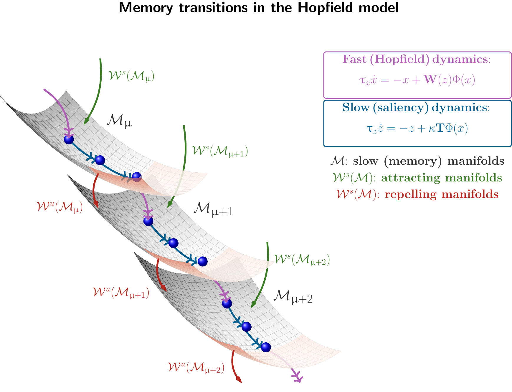
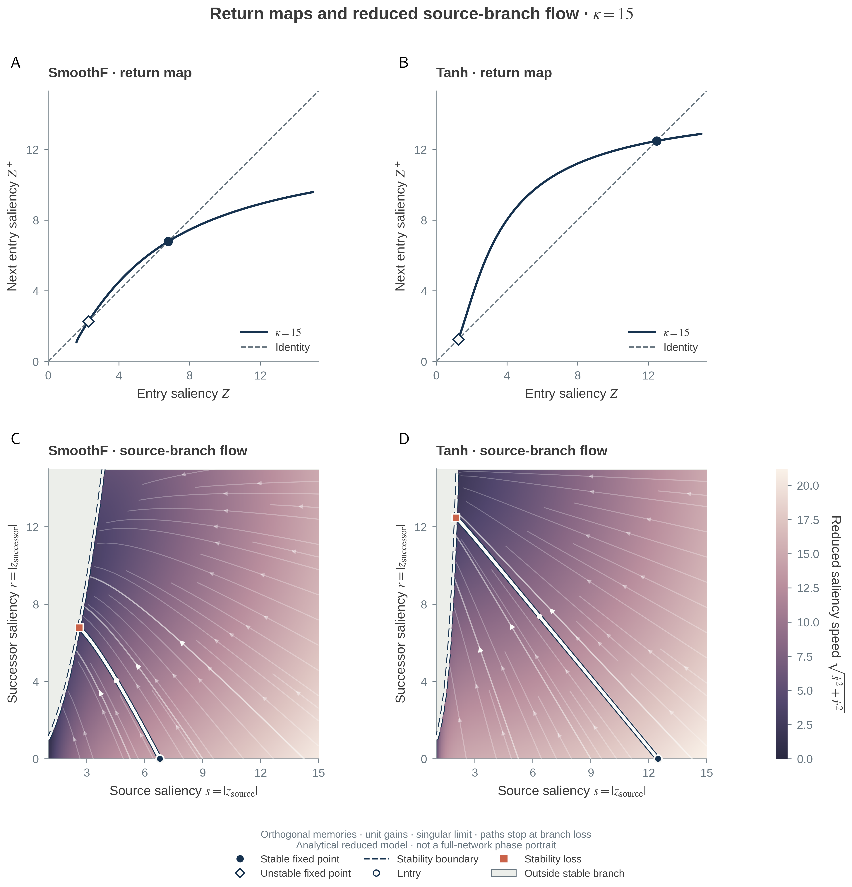
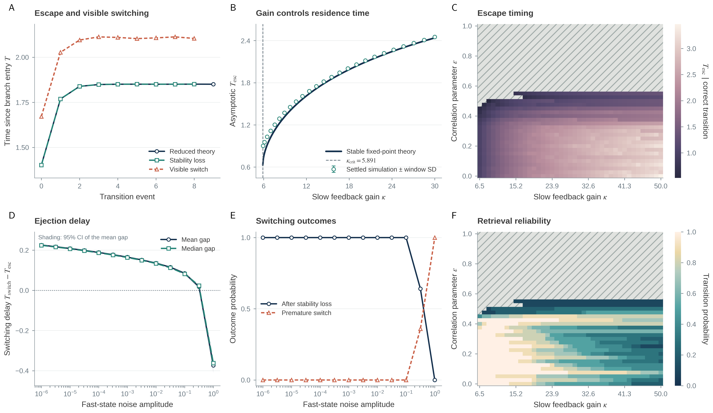
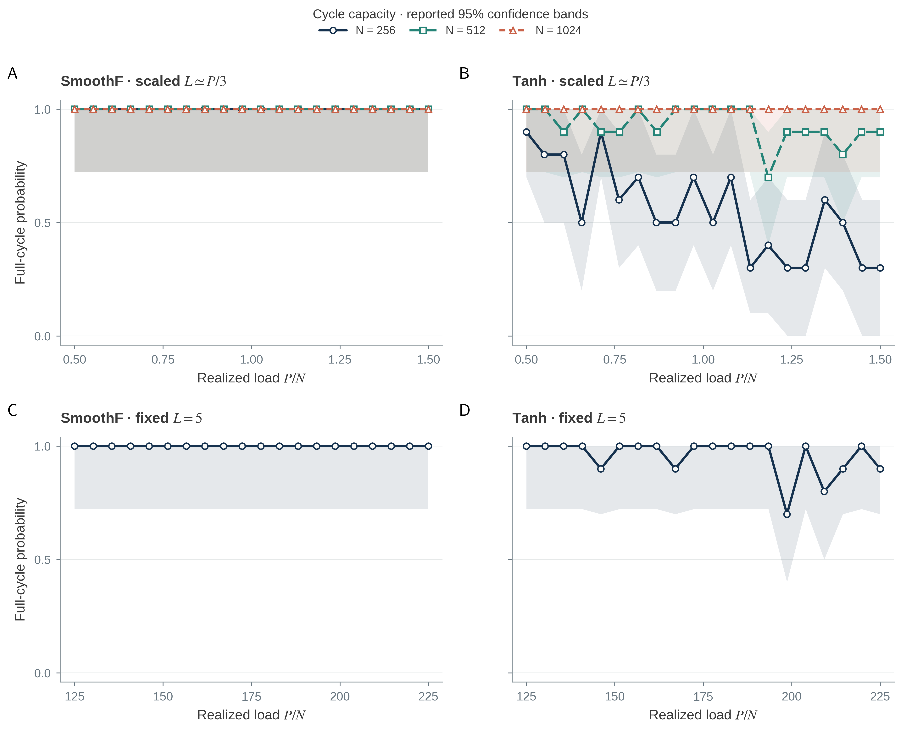
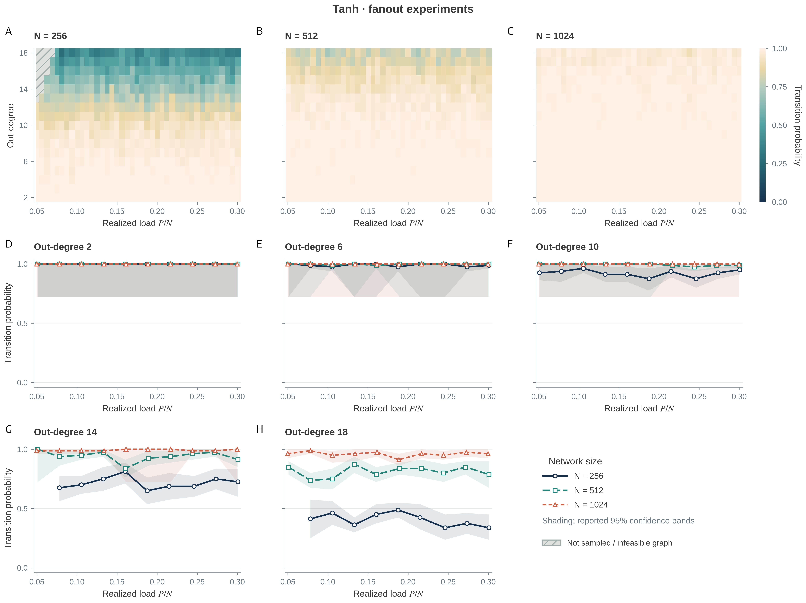
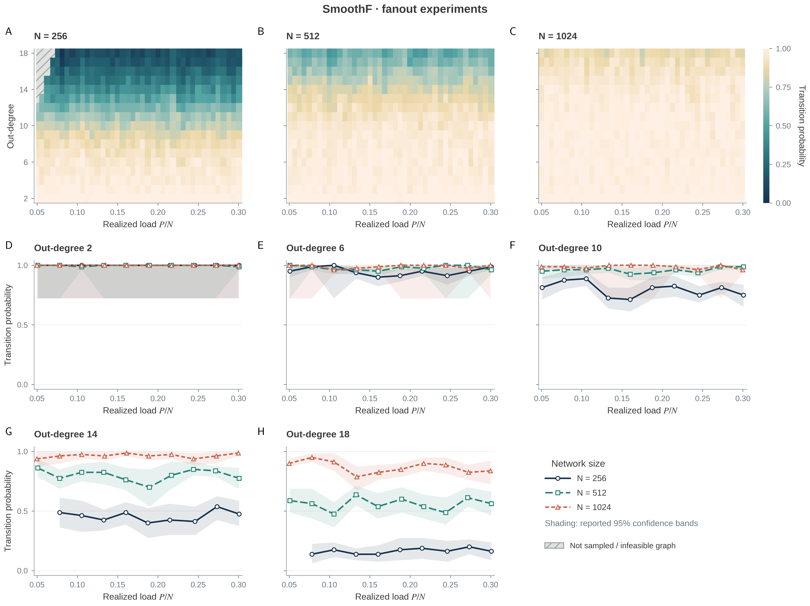

<div align="center">

# Memory flows

### Geometry and dynamics of sequential retrieval in input-driven Hopfield networks

[](#citation)
[](pyproject.toml)
[](#reproduce-the-results)
[](#reproducibility-design)

**Simone Betteti · Matteo Martin · Morten Gram Pedersen · Sandro Zampieri · Giacomo Baggio**

Accepted to the **NeurIPS 2026 Main Track**

[Visual overview](#the-mechanism-at-a-glance) · [Results](#results-at-a-glance) · [Quick start](#quick-start) · [Reproduce](#reproduce-the-results) · [Figure map](FIGURE_MAP.md) · [Technical guide](docs/TECHNICAL_GUIDE.md)

</div>

<p align="center">
  <a href="assets/readme/memory_manifolds.pdf"></a>
</p>

<p align="center"><em>
Fast Hopfield dynamics retrieve a memory; slow saliency feedback moves the system along its memory manifold until stability is lost and the next graph-connected memory is retrieved.
</em></p>

---

## Why this repository exists

Classical associative memories stop once a stored pattern is retrieved. This work introduces a minimal two-timescale extension of the input-driven plasticity (IDP) Hopfield model that supports **autonomous, graph-constrained sequences of memories** while retaining an explicit mathematical description of:

- where retrieval trajectories live geometrically;
- when a retrieved memory loses stability;
- which gain values sustain repeated transitions;
- when sequential retrieval collapses or becomes unreliable;
- how capacity, branching, noise, and memory correlations change the dynamics.

The repository contains the configuration-driven simulations, analytical reductions, statistical summaries, publication figures, and validation tools supporting the paper.

## The mechanism at a glance

The model couples a fast neural state $x\in\mathbb{R}^N$ to a slow saliency state $z\in\mathbb{R}^P$:

$$
\tau_x \dot{x}
=-x+M\text{diag}\!\bigl(\Phi(z)\bigr)M^\top\Psi(x),
\qquad
\tau_z \dot{z}
=-z+\frac{\kappa}{\sqrt N}AM^\top\Psi(x),
$$

where $M$ stores the memories, $A$ is the directed transition graph, and $\kappa$ is the slow-feedback gain.

| 1. Retrieve | 2. Route | 3. Escape | 4. Repeat |
|:--:|:--:|:--:|:--:|
| The fast state converges to a memory branch. | The retrieved memory drives the saliency of graph-connected successors. | The source branch crosses its stability boundary at $T_{\mathrm{esc}}$. | The fast state jumps to the successor manifold and the cycle continues. |

The geometric picture separates **memory fixation** from **memory transition**. Attracting regions capture nearby trajectories; saddle regions provide the unstable directions through which trajectories leave one memory and approach the next.

> **Key distinction.** $T_{\mathrm{esc}}$ is the first loss of source-branch stability. The later visible retrieval event is $T_{\mathrm{switch}}$. The repository records both quantities independently.

## Results at a glance

### Reduced dynamics predict the transition mechanism

<p align="center">
  <a href="figures/camera_ready/return_map_reduced_phase_plane_kappa_15.png"></a>
</p>

The slow-fast reduction yields a source-successor phase plane and a one-dimensional saliency return map. Its fixed points distinguish collapse from self-sustained retrieval and provide activation-specific critical gains.

### Escape theory remains informative beyond the ideal reduction

<p align="center">
  <a href="figures/camera_ready/correlation_noise_test.png"></a>
</p>

Theory and simulation agree on the gain dependence of escape times away from the critical regime. The accompanying phase planes show where correlated memories still support correct sequential retrieval and where fixation or transition failure emerges.

### Sequential reliability depends on the active graph, not only nominal load

<p align="center">
  <a href="figures/camera_ready/capacity_scaled_fixed_cycle.png"></a>
</p>

Growing cycles and fixed-length cycles probe different operational notions of capacity. A five-memory active cycle can remain reliable even when many additional memories are stored because saliency dynamically gates which patterns contribute strongly to the effective synaptic matrix.

### Branching transitions survive multiple competing successors

<table>
  <tr>
    <td width="50%"><a href="figures/camera_ready/Fanout_tanh.png"></a></td>
    <td width="50%"><a href="figures/camera_ready/Fanout_smoothf.png"></a></td>
  </tr>
  <tr>
    <td align="center"><strong>Tanh</strong></td>
    <td align="center"><strong>SmoothF</strong></td>
  </tr>
</table>

The fanout experiments vary both memory load and graph out-degree. Reliability decreases as more successors compete, especially for smaller networks, while the load dependence is weaker and realization-dependent.

## Quick start

### 1. Create the environment

Using Conda:

```bash
conda env create -f environment.yml
conda activate slow-fast-idp-hopfield
```

Or using a standard virtual environment:

```bash
python -m venv .venv
source .venv/bin/activate
python -m pip install --upgrade pip
python -m pip install -e ".[dev]"
```

### 2. Run the reduced end-to-end validation

```bash
./run_all.sh --smoke --workers 1 --skip-tex
```

This executes every simulation and plotting path with reduced settings, runs the tests, and checks the generated CSV contracts. Smoke outputs verify the software pipeline; they are not paper-scale estimates.

### 3. Inspect the publication figures

- Camera-ready composites: [`figures/camera_ready/`](figures/camera_ready/)
- Individual paper panels: [`figures/paper/`](figures/paper/)
- Figure-ready numerical tables: [`figures/data/`](figures/data/)
- Complete visual atlas: [`figures/editorial/Memory_Flows_Figure_Atlas.pdf`](figures/editorial/Memory_Flows_Figure_Atlas.pdf)

## Reproduce the results

### Full paper workflow

```bash
./run_all.sh --workers 8
```

The final campaign completed in approximately **2.4 hours** on the authors' allocated setup. Wall time depends on the available CPU allocation. Use `--workers 16` when 16 cores are assigned; omitting `--workers` lets the launcher detect the scheduler or container allocation.

Completed simulation jobs are checkpointed under `.checkpoints/<mode>/`. Re-running the same command after a wall-time interruption resumes completed jobs. The workflow stores per-stage timing reports under `logs/<mode>/`.

### Re-render figures without rerunning dynamics

```bash
python scripts/render_figures.py --mode paper
```

Plotting scripts read saved CSV files and never rerun the underlying simulations.

### Run one experiment

```bash
python experiments/run_escape_time.py \
  --config configs/paper/escape_time.yml \
  --output data/raw/paper/escape_time

python plotting/plot_escape_time.py \
  --input data/raw/paper/escape_time \
  --output figures/paper/escape_time_validation \
  --data-dir figures/data
```

## Experiment guide

| Scientific question | Configuration | Simulation | Main output |
|---|---|---|---|
| Does the reduced theory predict stability loss? | [`escape_time.yml`](configs/paper/escape_time.yml) | [`run_escape_time.py`](experiments/run_escape_time.py) | `escape_time_validation` |
| When do repeated transitions become self-sustained? | [`kappa_sweep.yml`](configs/paper/kappa_sweep.yml) | [`run_kappa_sweep.py`](experiments/run_kappa_sweep.py) | `kappa_sweep` |
| How does fast perturbation change ejection delay? | [`noise_sweep.yml`](configs/paper/noise_sweep.yml) | [`run_noise_sweep.py`](experiments/run_noise_sweep.py) | `noise_sweep` |
| How do cycle length, load, and fanout affect reliability? | [`capacity.yml`](configs/paper/capacity.yml) | [`run_capacity.py`](experiments/run_capacity.py) | capacity and fanout panels |
| How robust is retrieval to correlated memories? | [`correlation.yml`](configs/paper/correlation.yml) | [`run_correlation.py`](experiments/run_correlation.py) | `correlation` |
| Where do gain and correlation permit correct transitions? | [`correlation_phase_plane.yml`](configs/paper/correlation_phase_plane.yml) | [`run_correlation_phase_plane.py`](experiments/run_correlation_phase_plane.py) | `correlation_phase_plane` |

The complete mapping between paper panels, raw tables, plotters, and editable outputs is in [`FIGURE_MAP.md`](FIGURE_MAP.md).

## Repository map

```text
memory_flows_unified/
├── configs/
│   ├── paper/              # camera-ready numerical settings and fixed seeds
│   ├── smoke/              # reduced end-to-end validation settings
│   └── exploratory/        # retained non-canonical analyses
├── experiments/            # simulations; write CSV and JSON only
├── src/idp_hopfield/       # model, theory, events, graphs, statistics, I/O
├── plotting/               # figures generated from saved data
├── scripts/                # orchestration, benchmarking, QA, output checks
├── data/raw/               # event-, trial-, and summary-level outputs
├── figures/
│   ├── camera_ready/       # manuscript composite figures
│   ├── paper/              # PDF, SVG, and PNG figure masters
│   └── data/               # figure-ready tables
├── tests/                  # scientific and software regression tests
├── reports/                # design, protocol, performance, and QA reports
├── FIGURE_MAP.md           # paper figure to code/data map
├── VALIDATION.md           # executed checks and numerical reference values
└── PROVENANCE.md           # consolidation history and authoritative sources
```

Shared scientific definitions live in `src/idp_hopfield/`; experiment scripts do not import one another. This keeps activation, clock, graph-orientation, event, and statistical conventions consistent across figures.

## Reproducibility design

- **Configuration first.** Paper and smoke settings are explicit YAML files.
- **Deterministic randomness.** Fixed seeds are propagated with `numpy.random.SeedSequence`.
- **Separated simulation and rendering.** Experiments write data; plotting scripts consume it.
- **Auditable statistics.** Trial-level outputs are retained, and independently generated pattern matrices are the primary statistical units.
- **Resumable parallel execution.** Heavy sweeps share one CPU budget and cache completed jobs.
- **Multiple publication formats.** Figures are exported as PDF, editable-text SVG, and PNG.
- **Integrity records.** [`MANIFEST.sha256`](MANIFEST.sha256), [`VALIDATION.md`](VALIDATION.md), and [`PROVENANCE.md`](PROVENANCE.md) document the delivered package.
- **HPC execution.** The camera-ready numerical campaigns were run on the Leonardo high-performance computing system.

## Scientific scope

The rigorous memory-manifold analysis assumes mutually orthogonal memories and deterministic transition graphs with at most one outgoing edge per memory. Correlated patterns, random memories, generalized-pseudoinverse decoding, and branching graphs are numerical extensions used to probe robustness beyond that analytical setting.

For numerical conventions, CSV schemas, estimator definitions, caveats, and one-command examples for every experiment, see the [`technical guide`](docs/TECHNICAL_GUIDE.md). Executed checks and reference values are documented in [`VALIDATION.md`](VALIDATION.md).

## Citation

If this repository supports your research, please cite:

```bibtex
@inproceedings{betteti2026memoryflows,
  title     = {Memory Flows: Geometry and Dynamics of Sequential Retrieval in Input-Driven Hopfield Networks},
  author    = {Betteti, Simone and Martin, Matteo and Pedersen, Morten Gram and Zampieri, Sandro and Baggio, Giacomo},
  booktitle = {Advances in Neural Information Processing Systems},
  year      = {2026}
}
```

## Contact

Questions about the model or reproducibility package can be directed to **Simone Betteti** at `simone.betteti@ai4i.it`.

---

<div align="center">
<strong>Fast retrieval. Slow feedback. Structured memory flow.</strong>
</div>
